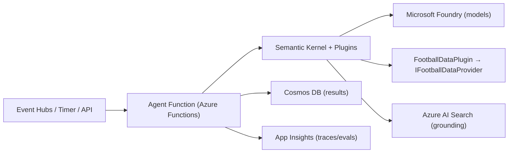

# AI Agents & Skills — AFC Demo

This document defines the **AI agents**, their **descriptions**, and the **Semantic Kernel
functions/skills (plugins)** they expose. Agents run as isolated **Azure Functions** using
**Semantic Kernel** over **Microsoft Foundry** models, with grounding via **Azure AI Search** and
persistence in **Cosmos DB**. All agents follow the WAF‑for‑AI guardrails in
[SECURITY.md](./SECURITY.md).

Skills/functions are written in C#. Signatures below are **illustrative contracts** for the code
generated from [docs/BOOTSTRAP_PROMPT.md](./docs/BOOTSTRAP_PROMPT.md) — treat them as the intended
shape, not final code.

---

## Conventions

- **Plugin** = a Semantic Kernel plugin (a group of related functions/skills).
- **Function** = a single `KernelFunction` (native C# or prompt function).
- Every agent: pins a **model/version**, logs prompts/outputs (PII‑filtered), scores **confidence**,
  and routes user‑facing content through **human‑in‑the‑loop** review before broad display.
- Agents never call 3rd‑party data directly — they use the `FootballDataPlugin` which wraps
  `IFootballDataProvider` (see the [ADR](./docs/ADR/0001-football-data-provider.md)).

---

## Agent 1 — Player Ratings Agent  *(Stage 5, flag: `player-ratings`)*

**Description:** After each match, estimate a 0–10 rating per Arsenal player from match statistics,
producing a short rationale. Combines with user‑submitted ratings for display. Deterministic,
stats‑grounded; low creativity.

**Trigger:** fixture `FullTime` event (from Event Hubs) → `afc-fn-ratings`.

**Plugins & functions**

| Plugin | Function | Type | Input → Output | Notes |
| --- | --- | --- | --- | --- |
| `FootballDataPlugin` | `GetMatchStats` | native | `fixtureId` → `MatchStats` | Per‑player stats via provider |
| `PlayerRatingsPlugin` | `EstimatePlayerRatings` | prompt | `MatchStats` → `AiRating[]` | Rubric‑based; returns score + rationale + confidence |
| `PlayerRatingsPlugin` | `BlendRatings` | native | `AiRating[]`, `UserRating[]` → `DisplayRating[]` | Weighted blend; flags divergence |
| `RatingsStorePlugin` | `SaveAiRatings` | native | `AiRating[]` → `void` | Cosmos `ratings` (source=`ai`) |
| `RatingsStorePlugin` | `SaveUserRating` | native | `UserRating` → `void` | Cosmos `ratings` (source=`user`) |

**Guardrails:** ratings are bounded 0–10, must cite driving stats; low‑confidence results are withheld
from display and queued for review.

```csharp
public sealed class PlayerRatingsPlugin
{
    [KernelFunction, Description("Estimate 0-10 ratings for each Arsenal player from match stats.")]
    public Task<IReadOnlyList<AiRating>> EstimatePlayerRatingsAsync(MatchStats stats, CancellationToken ct);

    [KernelFunction, Description("Blend AI and user ratings into a display value.")]
    public IReadOnlyList<DisplayRating> BlendRatings(IReadOnlyList<AiRating> ai, IReadOnlyList<UserRating> users);
}
```

---

## Agent 2 — Transfer News Agent  *(Stage 6, flag: `transfer-news`)*

**Description:** Once daily, aggregate Arsenal transfer rumours/news from configured public sources,
summarize each item, deduplicate, and score credibility/confidence. Output is **reviewed** before it
surfaces in the app.

**Trigger:** timer (daily) → `afc-fn-transfer`.

**Plugins & functions**

| Plugin | Function | Type | Input → Output | Notes |
| --- | --- | --- | --- | --- |
| `NewsSourcePlugin` | `FetchCandidates` | native | `since` → `RawItem[]` | Pull from configured sources/feeds |
| `TransferNewsPlugin` | `SummarizeItem` | prompt | `RawItem` → `TransferItem` | Neutral summary + entities |
| `TransferNewsPlugin` | `ScoreCredibility` | prompt | `TransferItem` → `confidence` | 0–1 with reasoning |
| `TransferNewsPlugin` | `Deduplicate` | native | `TransferItem[]` → `TransferItem[]` | Similarity clustering |
| `NewsStorePlugin` | `SaveTransfers` | native | `TransferItem[]` → `void` | Cosmos `transfers` |
| `ReviewPlugin` | `OpenReview` | native | `TransferItem[]` → `void` | Optional agentic GitHub PR for editorial review (see docs/CI_CD.md) |

**Guardrails:** items are stored as **draft**; only human‑approved (or above a confidence threshold
with clear labeling) items are shown. Sources are configurable and rate‑limited.

---

## Agent 3 — Search / Retrieval  *(Stage 7, flag: `search`)*

**Description:** Answer user queries over fixtures, results, past player ratings, and stats using
**Azure AI Search** as the retrieval layer, with optional natural‑language answering grounded in
retrieved documents.

**Trigger:** synchronous API call from the search UI → Core API → search skill.

**Plugins & functions**

| Plugin | Function | Type | Input → Output | Notes |
| --- | --- | --- | --- | --- |
| `SearchPlugin` | `Query` | native | `query`, `filters` → `SearchHit[]` | AI Search query (keyword + vector/semantic) |
| `SearchPlugin` | `AnswerGrounded` | prompt | `query`, `SearchHit[]` → `Answer` | Grounded answer + citations; refuses if unsupported |
| `IndexPlugin` | `ProjectFromCosmos` | native | change feed → index docs | Keeps `content-index` fresh |

**Guardrails:** answers must cite retrieved documents; if retrieval is weak, return results without a
generated claim (no ungrounded assertions).

---

## Shared plugin — `FootballDataPlugin`

Wraps `IFootballDataProvider` so agents and the Core API share one integration and one place to swap
providers (football-data.org ↔ API-Football).

| Function | Input → Output |
| --- | --- |
| `GetFixtures` | `competitionId`, `range` → `Fixture[]` |
| `GetStandings` | `competitionId` → `Standing[]` |
| `GetLineups` | `fixtureId` → `Lineup` *(requires API-Football)* |
| `GetMatchStats` | `fixtureId` → `MatchStats` *(requires API-Football)* |

---

## Model & configuration

- **Foundry deployment** per environment; model IDs/versions pinned in config and recorded in
  [CHANGELOG.md](./CHANGELOG.md).
- Temperature low for ratings/summaries (factual); retrieval‑augmented for search.
- Token/cost budgets enforced; failures degrade gracefully (feature flag can disable an agent).

## Observability & evaluation

- All agent runs emit traces to App Insights (latency, tokens, confidence, outcome).
- Offline **evaluation sets** (golden fixtures/queries) validate rating rubric stability and search
  relevance before flag rollout.

## Agent architecture (at a glance)


