# Architecture — AFC Demo

This document describes the **target architecture**, how it is **introduced stage‑by‑stage**, the
**subscription/environment topology**, **CI/CD**, the **AI/data flows**, and the mapping to the
**Azure Well‑Architected Framework (WAF)**.

Diagrams are authored as **Mermaid** (rendered by GitHub) so they can be regenerated/versioned as
code. Static exports (if needed) live in [`docs/diagrams/`](./docs/diagrams/).

---

## 1. Context (C4 — Level 1)

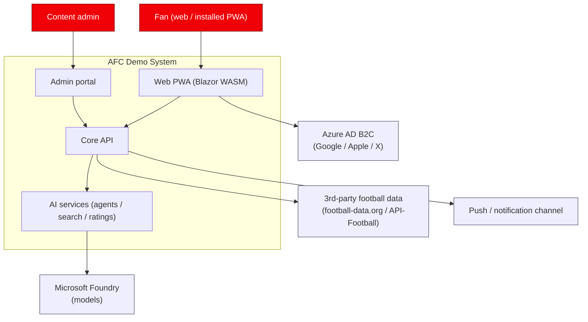

---

## 2. Target-state architecture (all stages complete)

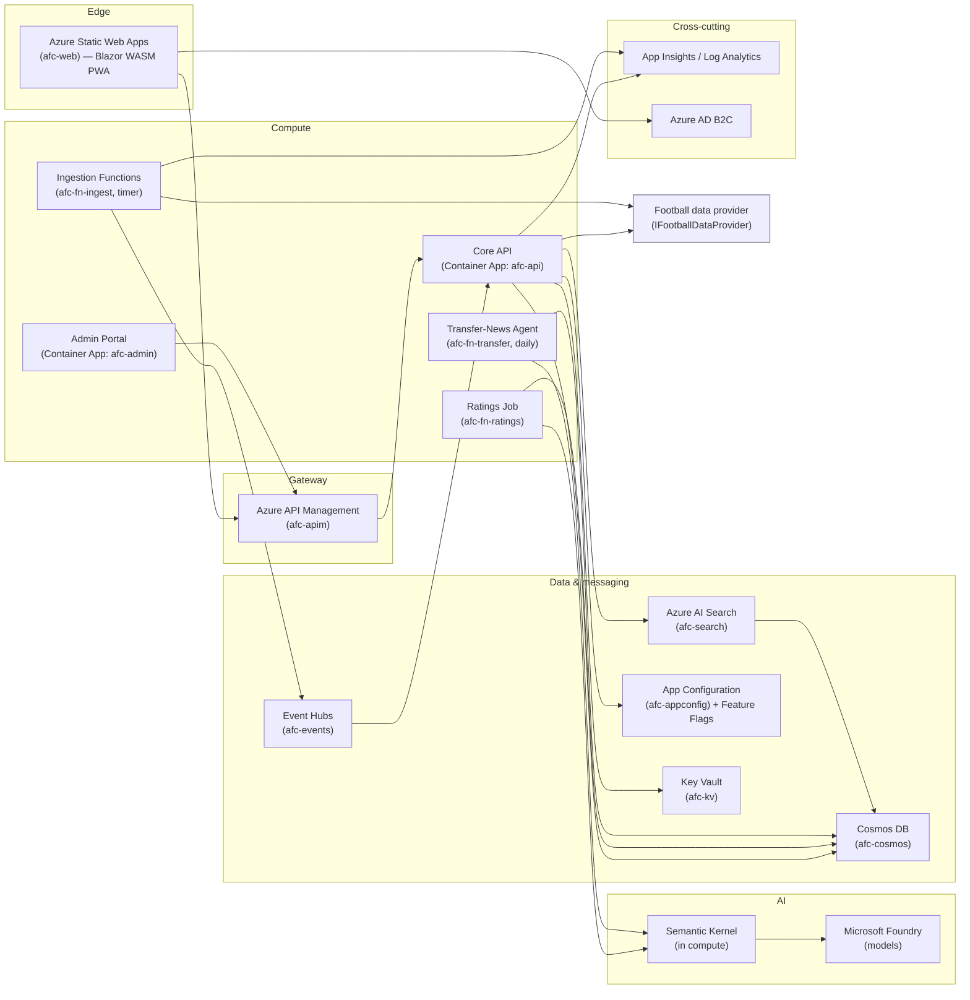

**Design intent**

- **APIM** fronts all callable APIs (Stage 8) for governance, throttling, product keys, and a stable
  contract for web + admin + future native iOS.
- **Core API** runs as a **Container App** (scales to zero, revisions for blue/green).
- **Event‑driven ingestion**: timer Functions poll the provider, publish fixture/lineup events to
  **Event Hubs**; the API projects them into Cosmos and triggers notifications.
- **AI features** are isolated Functions using **Semantic Kernel** over **Foundry** models, writing
  results to **Cosmos** and indexing into **AI Search**.
- **Config & secrets** are externalized to **App Configuration** (flags) and **Key Vault** (secrets),
  accessed via **managed identity**.

---

## 3. Staged architecture evolution

Infrastructure is introduced **only at the stage that needs it**. Every stage keeps a testable
baseline.

### Stage 1 — Local simple site (no cloud)

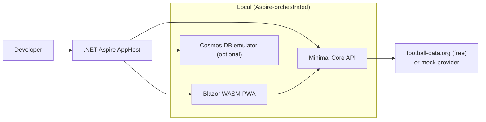

Testable: unit/component tests + Playwright e2e against the local Aspire run.

### Stage 2 — Deploy simple site to Azure

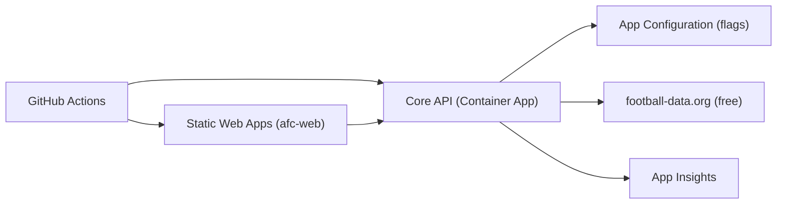

Adds: Bicep IaC, resource groups per environment, App Configuration, monitoring, CI/CD + manual + e2e.

### Stage 3 — Accounts & auth

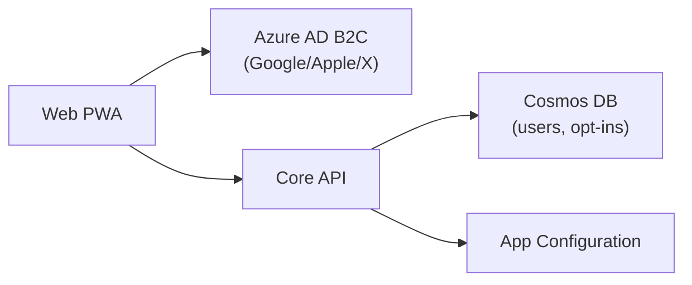

### Stage 4 — Lineup notifications (event‑driven; API‑Football)

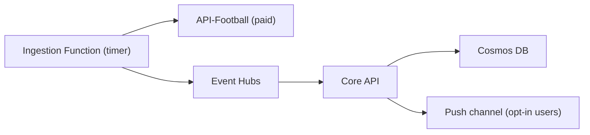

### Stage 5–7 — AI features

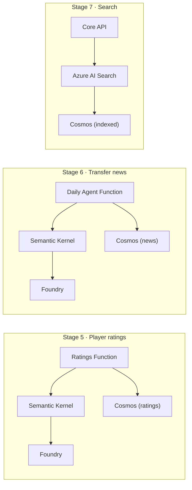

### Stage 8 — Governance & admin

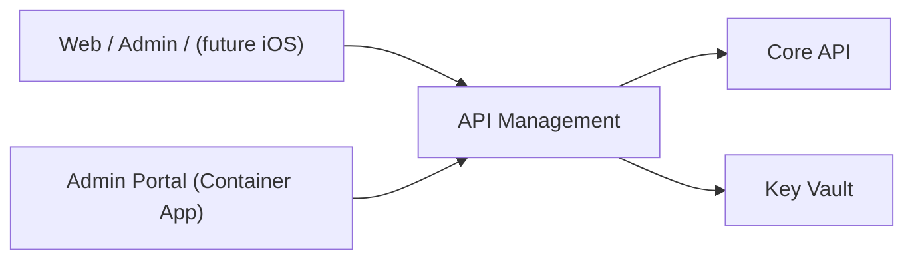

---

## 4. Subscription & environment topology (3‑subscription model)

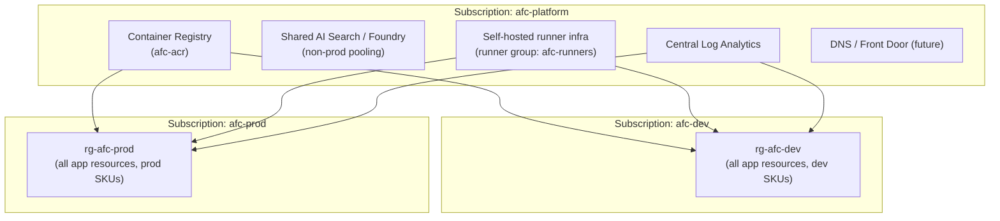

**Guidance**

- **`afc-platform`** — shared/expensive/long‑lived: ACR, central monitoring, runner infrastructure,
  DNS, and pooled AI capacity for non‑prod. Managed by the platform team; changes are rare and
  reviewed.
- **`afc-dev`** — full app stack at low‑cost SKUs; target of PR/CI deployments. Ephemeral‑friendly.
- **`afc-prod`** — hardened, prod SKUs, restricted access, deploy only via protected `prod`
  environment with required reviewers.
- **Region:** single US region to start — **East US 2** recommended (broad Foundry/model + service
  availability). All resources tagged with region for future multi‑region expansion.
- **Identity:** each environment uses **workload identity federation** (OIDC) from GitHub → Azure;
  no long‑lived cloud credentials in GitHub.

---

## 5. CI/CD flow

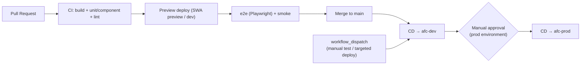

See [docs/CI_CD.md](./docs/CI_CD.md) for workflow skeletons, runner groups, and environments.

---

## 6. Feature‑flag strategy

- Backed by **Azure App Configuration** feature manager; evaluated with `Microsoft.FeatureManagement`
  in API and web.
- Flags: `trophy-screen` (**ON**), `lineup-notification` (**ON**), `player-ratings` (OFF),
  `transfer-news` (OFF), `search` (OFF), `premium-tier` (OFF).
- Flags support **targeting filters** (e.g., roll a feature to premium users or a % audience) and are
  changed **without redeploying**. Local dev uses a JSON fallback so the site runs offline.

---

## 7. Azure Well‑Architected Framework mapping

| Pillar | How the design addresses it |
| --- | --- |
| **Reliability** | Container Apps revisions + health probes; event‑driven ingestion decoupled via Event Hubs; Cosmos DB SLA + retry policies; staged rollout keeps a known‑good baseline; provider abstraction avoids single 3rd‑party lock. |
| **Security** | Azure AD B2C for identity; managed identities everywhere (no keys in code); Key Vault for secrets; APIM for gateway policy, throttling, and product keys; least‑privilege RBAC per subscription; see [SECURITY.md](./SECURITY.md). |
| **Cost Optimization** | Scale‑to‑zero Container Apps + Functions consumption; free/low SKUs in `afc-dev`; pooled non‑prod AI capacity in `afc-platform`; feature flags avoid shipping idle compute; free football data tier until paid data is required. |
| **Operational Excellence** | Everything as code (Bicep + Mermaid + workflows); per‑stage checklists; App Insights/Log Analytics; agentic GitHub for routine PRs; changelog + ADRs. |
| **Performance Efficiency** | CDN‑delivered static PWA; async ingestion; AI Search for fast retrieval; Cosmos partitioning by competition/season; Foundry model selection per workload. |

> The AI workloads additionally follow the **WAF for AI** guidance: model/version pinning, prompt &
> output logging (privacy‑filtered), grounding via AI Search, and human‑in‑the‑loop for user‑facing
> ratings/news.

---

## 8. Data model (high level)

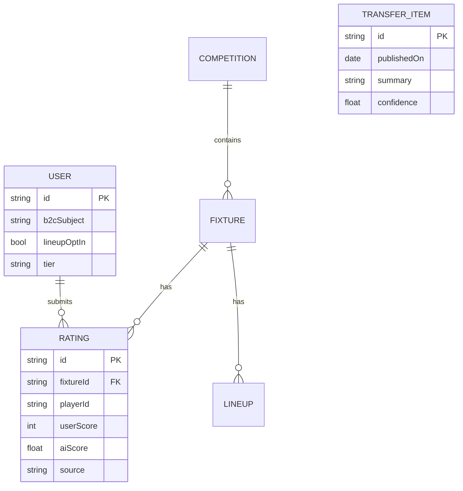

- **Cosmos containers** partitioned for scale: `users` (/id), `fixtures` (/competitionId),
  `ratings` (/fixtureId), `transfers` (/publishedOn), `content-index` for search projection.

---

## 9. Naming & tagging standards

**Resource naming (kebab-case):** `afc-<workload>-<env>`

| Resource | Example (dev) |
| --- | --- |
| Resource group | `rg-afc-dev` |
| Static Web App | `afc-web-dev` |
| Core API (Container App) | `afc-api-dev` |
| Function apps | `afc-fn-ingest-dev`, `afc-fn-ratings-dev`, `afc-fn-transfer-dev` |
| Cosmos DB | `afc-cosmos-dev` |
| Event Hubs namespace | `afc-events-dev` |
| API Management | `afc-apim-dev` |
| AI Search | `afc-search-dev` |
| App Configuration | `afc-appconfig-dev` |
| Key Vault | `afc-kv-dev` |
| Container Registry (platform) | `afcacrplatform` (registry names are alphanumeric) |

**Required tags:** `app=afc`, `env=dev|prod|platform`, `owner=<team>`, `costCenter=<id>`,
`region=eastus2`, `managedBy=bicep`.

**GitHub (kebab-case):** repos/branches/workflows/labels use kebab-case
(e.g. `ci.yml`, `cd-dev.yml`, `e2e.yml`, branch `feat/trophy-screen`). Markdown files use
`UPPERCASE_WITH_UNDERSCORES`.

---

## 10. Key decisions

- **Football data provider** — start free (football-data.org), upgrade to API-Football when lineups /
  match stats / transfers are needed. See
  [ADR‑0001](./docs/ADR/0001-football-data-provider.md).
- **Frontend = Blazor WASM PWA** — aligns with C# stack, installable on iOS as a stopgap before the
  deferred native app, and is a natural fit for Static Web Apps.
- **iOS native deferred** — responsive PWA first; APNs/native path documented in
  [ROADMAP.md](./ROADMAP.md).
