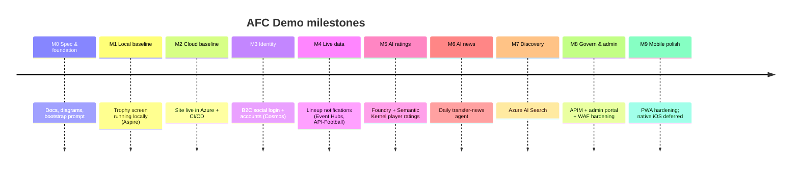

# Delivery Plan — AFC Demo

A **staged**, test‑driven delivery plan. Each stage has an **exit criteria / checklist** and must be
**green and demoable** before the next stage begins. Infrastructure and features are introduced only
when the stage requires them.

Legend: ☐ = to do · ✅ = done. Update the checkboxes as work completes and mirror notable changes in
[CHANGELOG.md](./CHANGELOG.md).

---

## Milestone overview

| Milestone | Stage | Theme | Primary Azure assets introduced |
| --- | --- | --- | --- |
| M0 | 0 | Spec & foundation | — (repo, docs, workflow skeletons) |
| M1 | 1 | Local simple site | — (Aspire local only) |
| M2 | 2 | Deploy to Azure | Static Web Apps, Container Apps, App Config, App Insights, Bicep, ACR |
| M3 | 3 | Accounts & auth | Azure AD B2C, Cosmos DB |
| M4 | 4 | Lineup notifications | Event Hubs, ingestion Functions, push channel |
| M5 | 5 | Player ratings | Foundry, Semantic Kernel, ratings Function |
| M6 | 6 | Transfer news | Scheduled agent Function |
| M7 | 7 | Search | Azure AI Search |
| M8 | 8 | Governance & admin | API Management, Admin portal, Key Vault hardening |
| M9 | 9 | Mobile polish | (PWA hardening; iOS deferred) |

---

## Per‑stage checklists

### Stage 0 — Spec & foundation

- ✅ Documentation package (README, ARCHITECTURE, SECURITY, ROADMAP, SETUP, CHANGELOG, this plan, AGENTS)
- ✅ Architecture diagrams (Mermaid)
- ✅ PR template + CI/CD strategy + workflow skeletons
- ✅ ADR‑0001 (football data provider)
- ✅ Bootstrap prompt + execution playbook + per‑stage prompts
- ✅ Markdown lint config + `docs-lint` CI workflow; **markdown lint passes** (0 issues)
- ✅ `CODEOWNERS` (reviewer sign‑off gate)
- ✅ Repo structure matches README
- ✅ Repo settings **codified** as `scripts/setup-github.ps1` + [docs/REPO_SETUP.md](./docs/REPO_SETUP.md):
  branch protection, environments (`dev`, `prod`), runner group `afc-runners`
- ✅ Repo created & pushed: [`naytron/afc-demo`](https://github.com/naytron/afc-demo) (**public**)
- ✅ Repo settings **applied**: branch protection on `main` (1 review + CODEOWNERS + `docs-lint`
  check + linear history + conversation resolution, no force‑push/delete), `dev`/`prod` environments,
  and the `prod` **required‑reviewer** approval gate (reviewer: `Naytron`) + branch policy
- ☐ `afc-runners` runner group — **deferred** (org‑only feature; see
  [Plan limitations](./docs/REPO_SETUP.md#4-plan-limitations-current-repo))
- **Exit:** markdown lint passes; repo structure matches README; reviewers sign off on the spec.

### Stage 1 — Local simple site

- ✅ .NET Aspire AppHost orchestrating Web (Blazor WASM PWA) + minimal Core API
- ✅ Trophy/standings **home screen**: next/live fixture + standing per competition
- ✅ Clickable trophy → competition detail (standings/stats) screen
- ✅ `IFootballDataProvider` with football-data.org implementation **and** a mock provider
- ✅ Feature-flag plumbing with local JSON fallback (`trophy-screen`, `lineup-notification` ON)
- ✅ Unit + component tests; **Playwright e2e** run locally and in CI
- **Exit:** `dotnet run` on AppHost serves the site; all tests are green locally; the CI workflow
  runs the same build, test, and e2e gates on push/PR; no cloud dependency.

| Component | Target | Deps updated | Builds | Tests | Deployed | Notes |
| --- | --- | --- | --- | --- | --- | --- |
| afc-web (PWA) | net (latest LTS) | ✅ | ✅ | ✅ | n/a | Blazor WASM |
| afc-api (minimal) | net (latest LTS) | ✅ | ✅ | ✅ | n/a | Trophy/standings endpoints |
| afc-apphost (Aspire) | net (latest LTS) | ✅ | ✅ | ✅ | n/a | Local orchestration |

### Stage 2 — Deploy simple site to Azure

- ✅ Bicep IaC for `rg-afc-dev` (SWA, Container App API, App Config, App Insights, ACR use)
- ✅ GitHub OIDC federation to `afc-dev` and `afc-prod`
- ✅ Workflows: `ci.yml`, `cd-dev.yml`, `cd-prod.yml` (approval), `e2e.yml`, `manual-test.yml`
- ✅ Preview environments on PR; smoke + e2e against deployed preview
- ✅ Prod environment with required reviewers; single region East US 2
- **Exit:** dev is deployed and validated; after this branch is merged, an approved release deploys the
  same immutable build to `afc-prod`. Deployed smoke + e2e are green; rollback is documented.

| Component | Target | Deps | Builds | Tests | Deploy verified | Notes |
| --- | --- | --- | --- | --- | --- | --- |
| afc-web-dev/prod | SWA | ✅ | ✅ | ✅ | dev ✅; prod protected | |
| afc-api-dev/prod | Container App | ✅ | ✅ | ✅ | dev ✅; prod protected | |
| afc-appconfig | App Config | ✅ | ✅ | ✅ | dev ✅; prod protected | flags |

### Stage 3 — Accounts & auth

- ☐ Azure AD B2C tenant + user flows; social IdPs: **Google, Apple, X**
- ☐ Sign up / sign in from the home screen (single simple screen)
- ☐ Cosmos DB `users` container; profile + `lineupOptIn`
- ☐ Authn/z on API (validate B2C tokens); anonymous still sees trophy screen
- ☐ e2e covering anonymous + authenticated paths
- **Exit:** a user can create/sign in via each social IdP and their opt‑in persists.

### Stage 4 — Lineup notifications (default ON)

- ☐ Switch provider to **API-Football** (lineups) behind the abstraction
- ☐ Timer ingestion Function → Event Hubs (`fixture`/`lineup` events)
- ☐ Core API projects events to Cosmos; triggers push to opted‑in users
- ☐ Push channel wired (web push; note APNs for future native)
- ☐ Integration test: simulated lineup event → notification delivered
- **Exit:** posting a lineup event notifies opted‑in accounts; trophy screen still green.

### Stage 5 — Player ratings (flagged)

- ☐ Ratings Function using **Semantic Kernel** + **Foundry** to estimate ratings from match stats
- ☐ User rating submission stored in Cosmos `ratings`
- ☐ Blend/display AI + user ratings; guardrails + human‑in‑the‑loop note
- ☐ Feature flag `player-ratings` (targeting: enable for testers/premium)
- **Exit:** post‑match AI ratings generated and users can rate; disabled cleanly when flag off.

### Stage 6 — Transfer news (flagged)

- ☐ Daily scheduled agent Function (Semantic Kernel) aggregates Arsenal transfer rumours/news
- ☐ Store `transfers` in Cosmos with source + confidence; dedupe
- ☐ Optional agentic GitHub pattern for content review PRs (see docs/CI_CD.md)
- ☐ Feature flag `transfer-news`
- **Exit:** daily run produces reviewed transfer items surfaced in the app when flag on.

### Stage 7 — Search (flagged)

- ☐ Azure AI Search index over fixtures/results/ratings/stats projected from Cosmos
- ☐ Search API + UI; relevance tuning; grounding for AI answers
- ☐ Feature flag `search`
- **Exit:** users can search results/players/ratings/stats with relevant hits.

### Stage 8 — Governance & admin

- ☐ **API Management** in front of Core API (products, keys, rate limits, policies)
- ☐ **Admin portal** (Container App) for content/data edits (CRUD) with admin RBAC
- ☐ Key Vault hardening, WAF security review, cost review, alerting/dashboards
- **Exit:** all clients call via APIM; admins manage data; WAF review actioned.

### Stage 9 — Mobile polish

- ☐ PWA install/offline/responsive hardening across iOS Safari
- ☐ Document native iOS plan (MAUI vs Swift) + APNs push migration
- **Exit:** installable, responsive experience validated on iOS; native path documented.

---

## Definition of Done (every stage)

1. Builds green in CI. 2. Unit/component + e2e green. 3. Deployed (Stage 2+) and smoke‑tested.
2. Feature flags behave (on/off). 5. Docs + CHANGELOG updated. 6. WAF quick‑check for new assets.

## Risks & mitigations

| Risk | Mitigation |
| --- | --- |
| Free data tier lacks lineups/stats | Provider abstraction; upgrade to API-Football at Stage 4 (planned). |
| iOS PWA push limitations | Web push now; APNs/native documented for Stage 9/future. |
| AI hallucination in news/ratings | Grounding via AI Search, confidence scoring, human‑in‑the‑loop review. |
| Cost creep from AI/search | Scale‑to‑zero, pooled non‑prod capacity, flags to disable idle features. |
| 3rd‑party rate limits | Cache in Cosmos, ingestion cadence tuning, APIM throttling. |
