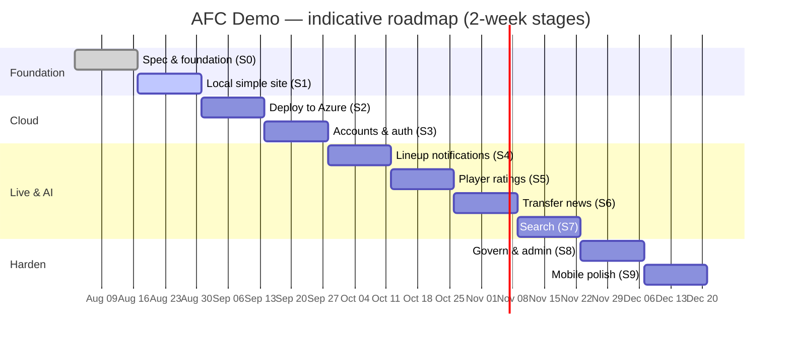

# Roadmap — AFC Demo

The roadmap ties **features** to **delivery stages** (see [DELIVERY_PLAN.md](./DELIVERY_PLAN.md)) and
to the **feature‑flag rollout**. Everything is delivered incrementally so a testable baseline is
always available.

---

## Guiding principles
- **Testable baseline every stage** — never break the running Trophy screen.
- **Introduce infra just‑in‑time** — a service appears only when a feature needs it.
- **Flags over branches** — features merge early, hidden behind flags, and roll out via targeting.
- **AI with guardrails** — grounding, confidence, and human‑in‑the‑loop for user‑facing content.

---

## Feature → stage → flag matrix

| Feature | Stage | Flag | Default | Rollout approach |
| --- | --- | --- | --- | --- |
| Trophy standing screen (home) | 1 | `trophy-screen` | **ON** | GA from Stage 1 |
| Accounts & social login | 3 | (core, not flagged) | ON | GA at Stage 3 |
| Lineup notification | 4 | `lineup-notification` | **ON** | GA; opt‑in per user |
| Player ratings | 5 | `player-ratings` | OFF | Testers → premium → % audience → GA |
| Transfer news | 6 | `transfer-news` | OFF | Internal review → GA |
| Search | 7 | `search` | OFF | Beta cohort → GA |
| Premium account tier | Future | `premium-tier` | OFF | Enables higher‑tier features |
| Native iOS app | Future | n/a | — | After PWA validation (Stage 9) |

---

## Timeline (indicative)

---

## Near‑term (MVP: Stages 1–4)
- Trophy/standings home + competition detail screens.
- Deploy to Azure with full CI/CD, previews, and e2e.
- B2C social login and account opt‑ins.
- Live lineup notifications (upgrade to API-Football).

## Mid‑term (Stages 5–7)
- AI player ratings (Foundry + Semantic Kernel) + user ratings.
- Daily AI transfer‑news agent.
- AI Search across results/players/ratings/stats.

## Longer‑term (Stage 8+ / Future)
- API Management governance + backend admin portal.
- **Premium account tier** unlocking additional features.
- **Native iOS app** (evaluate .NET MAUI vs Swift) with **APNs** push, replacing web‑push where
  richer capabilities are needed.
- Multi‑region expansion (design already tags region for portability).
- Additional social/data integrations and richer stats.

---

## Explicitly deferred (documented, not in MVP)
- Native mobile apps (iOS first) — **deferred**; responsive PWA ships first.
- Multi‑region / DR — single US region (East US 2) to start.
- CMK encryption, Front Door/edge WAF — noted as future hardening.

See [CHANGELOG.md](./CHANGELOG.md) for what has actually shipped.
