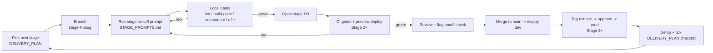

# Execution Playbook — AFC Demo

**How to actually build AFC Demo in clear, testable stages.** `DELIVERY_PLAN.md` says *what* each
stage delivers and its exit criteria; this playbook says *how* you drive each stage forward so the
baseline stays green and every stage is provably done before the next begins.

It is a **prompt‑driven, one‑PR‑per‑stage** model:

1. Pick the next stage from [DELIVERY_PLAN.md](../DELIVERY_PLAN.md).
2. Hand its **scoped kickoff prompt** from [STAGE_PROMPTS.md](./STAGE_PROMPTS.md) (Stage 1 uses
   [BOOTSTRAP_PROMPT.md](./BOOTSTRAP_PROMPT.md)) to the Copilot coding agent — or build it yourself.
3. Gate the result against this playbook's **test gates**.
4. Open **one PR for the stage**, review, merge, tag, demo.
5. Only then start the next stage.

---

## 1. Principles

- **Green baseline, always.** `main` is demoable at the end of every stage. A stage never regresses a
  prior stage's exit criteria.
- **Just‑in‑time infrastructure.** Azure assets are introduced only in the stage that needs them
  (see the milestone table in [DELIVERY_PLAN.md](../DELIVERY_PLAN.md)), never up front.
- **New features land OFF.** Every new feature ships behind a flag that is **OFF** by default; only
  `trophy-screen` and `lineup-notification` are ON. Flipping a flag — not a redeploy — turns a feature
  on. This is what keeps the baseline green while new code lands.
- **Scoped prompts, not big‑bang.** Each stage has a narrow, testable prompt. The agent is told what
  **not** to build so later stages stay clean.
- **One PR per stage.** The stage PR is the unit of review, test, and rollback.

---

## 2. The per‑stage loop

Steps in words:

1. **Branch** from `main`: `stage-<n>-<slug>` (e.g. `stage-2-deploy-to-azure`).
2. **Kick off** with the stage prompt. Work in small, reviewable commits.
3. **Local gates** must pass before pushing (Section 4).
4. **Open the stage PR** (Section 3). CI runs the gates; Stage 2+ also deploys a **preview** and runs
   e2e/smoke against it.
5. **Review** includes an explicit **flag on/off check** — the feature works when its flag is on and is
   fully absent (no errors, no UI) when off.
6. **Merge to `main`** → auto‑deploy to `afc-dev` (Stage 2+).
7. **Tag a release** → required‑reviewer approval → deploy to `afc-prod` (Stage 2+).
8. **Demo** the stage and tick its checklist in [DELIVERY_PLAN.md](../DELIVERY_PLAN.md); update
   [CHANGELOG.md](../CHANGELOG.md).

---

## 3. Branching, PRs, and labels

| Item | Convention | Example |
| --- | --- | --- |
| Stage branch | `stage-<n>-<slug>` (kebab‑case) | `stage-4-lineup-notifications` |
| Sub‑task branch (optional, large stages) | `stage-<n>-<slug>/<task>` merged into the stage branch first | `stage-4-lineup-notifications/ingestion-fn` |
| PR title | `Stage <n> — <Theme>` | `Stage 3 — Accounts & auth` |
| PR label(s) | `stage-<n>`, plus `breaking-change` when APIs/contracts change | `stage-3`, `breaking-change` |
| Release tag | `v0.<n>.0` aligned to the stage/milestone | `v0.3.0` |

**One PR per stage** to `main`. Large stages may use short‑lived sub‑task branches that merge into the
stage branch, but the stage still lands on `main` as a single, reviewable PR. Fill in
[`.github/PULL_REQUEST_TEMPLATE.md`](../.github/PULL_REQUEST_TEMPLATE.md) — including the stage, the
flags touched, and the WAF quick‑check.

---

## 4. Test gates

A gate is a hard pass/fail check. A stage is not done until **all applicable gates are green** locally
**and** in CI. Gates map to the workflows in [docs/CI_CD.md](./CI_CD.md).

| Gate | What it checks | Tooling | From stage |
| --- | --- | --- | --- |
| **G0 Lint/format** | Style, formatting, markdown, no drift | `dotnet format --verify-no-changes`, markdownlint, `.editorconfig` | 0 |
| **G1 Build** | Solution compiles, containers build | `dotnet build`, `docker build` | 1 |
| **G2 Unit** | Domain/provider/logic units | `dotnet test` (unit) | 1 |
| **G3 Component** | Blazor components render/behave | bUnit | 1 |
| **G4 Integration** | Cross‑component paths (emulators/local resources) | `dotnet test` (integration), Cosmos/Event Hubs emulators | 3 |
| **G5 e2e** | User journeys end‑to‑end | Playwright — local vs Aspire (Stage 1), vs **preview** (Stage 2+) | 1 |
| **G6 Deployed smoke** | Deployed app is alive & correct | smoke script against `afc-dev` / preview | 2 |
| **G7 Flag behavior** | Feature on works; off is fully absent | e2e run with flag on **and** off | 1 |
| **G8 Security/WAF check** | New assets: identity, secrets, network, cost | checklist in [SECURITY.md](../SECURITY.md) + PR template | 2 |

**Per‑stage gate matrix** (● required · ○ n/a):

| Stage | G0 | G1 | G2 | G3 | G4 | G5 | G6 | G7 | G8 |
| --- | :-: | :-: | :-: | :-: | :-: | :-: | :-: | :-: | :-: |
| 0 Spec | ● | ○ | ○ | ○ | ○ | ○ | ○ | ○ | ○ |
| 1 Local site | ● | ● | ● | ● | ○ | ● | ○ | ● | ○ |
| 2 Deploy | ● | ● | ● | ● | ○ | ● | ● | ● | ● |
| 3 Auth | ● | ● | ● | ● | ● | ● | ● | ● | ● |
| 4 Lineups | ● | ● | ● | ● | ● | ● | ● | ● | ● |
| 5 Ratings | ● | ● | ● | ● | ● | ● | ● | ● | ● |
| 6 News | ● | ● | ● | ● | ● | ● | ● | ● | ● |
| 7 Search | ● | ● | ● | ● | ● | ● | ● | ● | ● |
| 8 Govern/admin | ● | ● | ● | ● | ● | ● | ● | ● | ● |
| 9 Mobile | ● | ● | ● | ● | ○ | ● | ● | ● | ● |

---

## 5. Environments & promotion

Promotion is defined in [docs/CI_CD.md](./CI_CD.md) and the [ARCHITECTURE.md](../ARCHITECTURE.md)
subscription topology. In short:

- **PR opened (Stage 2+)** → ephemeral **preview** environment; G5/G6 run against it.
- **Merge to `main`** → deploy to **`afc-dev`** automatically.
- **Tag `v0.n.0`** → **`afc-prod`** deploy behind a **required‑reviewer** approval gate.
- Shared assets (ACR, App Config, monitoring, AI Search/Foundry pooling) live in **`afc-platform`**.
- Region: **East US 2** to start (Foundry/model availability).

Auth to Azure is **GitHub OIDC workload identity federation** — no stored cloud credentials.

---

## 6. Feature‑flag discipline

- Flags live in **Azure App Configuration** (`Microsoft.FeatureManagement`) with a **local JSON
  fallback** for offline dev.
- A new stage's feature is registered **OFF** (except the two default‑ON features). It is enabled per
  environment by flipping the flag — dev first (for demo/test), prod later.
- **G7** proves both states. If a feature can't be cleanly turned off, it isn't done.
- Use **targeting filters** (e.g. testers/premium) to demo a feature to a subset before broad enablement
  (`player-ratings`, `premium-tier`).

---

## 7. Definition of Done (every stage)

Mirror of [DELIVERY_PLAN.md](../DELIVERY_PLAN.md#definition-of-done-every-stage): builds green in CI ·
unit/component/e2e green · deployed & smoke‑tested (Stage 2+) · flags behave on/off · docs + CHANGELOG
updated · WAF quick‑check for new assets · the stage's checklist in `DELIVERY_PLAN.md` fully ticked.

---

## 8. Rollback & recovery

- **Revert the stage PR** — because a stage is one PR, `git revert` cleanly removes it.
- **Redeploy the previous image tag / release** to `afc-dev`/`afc-prod` (immutable tags in ACR).
- **Kill‑switch via flags** — turn the feature's flag off to neutralise it instantly without a deploy.
- Keep `main` releasable at all times; never leave it red overnight.

---

## 9. Stage → prompt → exit‑criteria map

| Stage | Kickoff prompt | Exit criteria (authoritative) |
| --- | --- | --- |
| 1 | [BOOTSTRAP_PROMPT.md](./BOOTSTRAP_PROMPT.md) | [Stage 1](../DELIVERY_PLAN.md#stage-1--local-simple-site) |
| 2 | [STAGE_PROMPTS.md § Stage 2](./STAGE_PROMPTS.md#stage-2--deploy-the-simple-site-to-azure) | [Stage 2](../DELIVERY_PLAN.md#stage-2--deploy-simple-site-to-azure) |
| 3 | [STAGE_PROMPTS.md § Stage 3](./STAGE_PROMPTS.md#stage-3--accounts--auth) | [Stage 3](../DELIVERY_PLAN.md#stage-3--accounts--auth) |
| 4 | [STAGE_PROMPTS.md § Stage 4](./STAGE_PROMPTS.md#stage-4--lineup-notifications) | [Stage 4](../DELIVERY_PLAN.md#stage-4--lineup-notifications-default-on) |
| 5 | [STAGE_PROMPTS.md § Stage 5](./STAGE_PROMPTS.md#stage-5--player-ratings) | [Stage 5](../DELIVERY_PLAN.md#stage-5--player-ratings-flagged) |
| 6 | [STAGE_PROMPTS.md § Stage 6](./STAGE_PROMPTS.md#stage-6--transfer-news) | [Stage 6](../DELIVERY_PLAN.md#stage-6--transfer-news-flagged) |
| 7 | [STAGE_PROMPTS.md § Stage 7](./STAGE_PROMPTS.md#stage-7--search) | [Stage 7](../DELIVERY_PLAN.md#stage-7--search-flagged) |
| 8 | [STAGE_PROMPTS.md § Stage 8](./STAGE_PROMPTS.md#stage-8--governance--admin) | [Stage 8](../DELIVERY_PLAN.md#stage-8--governance--admin) |
| 9 | [STAGE_PROMPTS.md § Stage 9](./STAGE_PROMPTS.md#stage-9--mobile-polish) | [Stage 9](../DELIVERY_PLAN.md#stage-9--mobile-polish) |

---

## 10. Roles

- **You (CSA / reviewer):** pick the stage, run the prompt, review the PR, approve prod, run the demo.
- **Copilot coding agent:** executes the scoped prompt, opens the PR, iterates on gate failures.
- **Agentic GitHub jobs (Stage 6+):** the daily transfer‑news job may open content‑review PRs — see the
  agentic patterns in [docs/CI_CD.md](./CI_CD.md).

---

## 11. Before you start (Stage 0 groundwork)

One‑time repo setup so the loop runs cleanly:

- Branch protection on `main` (require PR + green checks + 1 review).
- GitHub **environments** `dev` and `prod`; `prod` requires reviewers.
- **Runner group** `afc-runners` (see [docs/CI_CD.md](./CI_CD.md)).
- Azure OIDC federation for `afc-dev` and `afc-prod` (added/verified in Stage 2).
- Convert the documented workflow skeletons in [docs/CI_CD.md](./CI_CD.md) into live
  `.github/workflows/*.yml` when Stage 2 needs them (Stage 1 needs only `ci.yml`).
